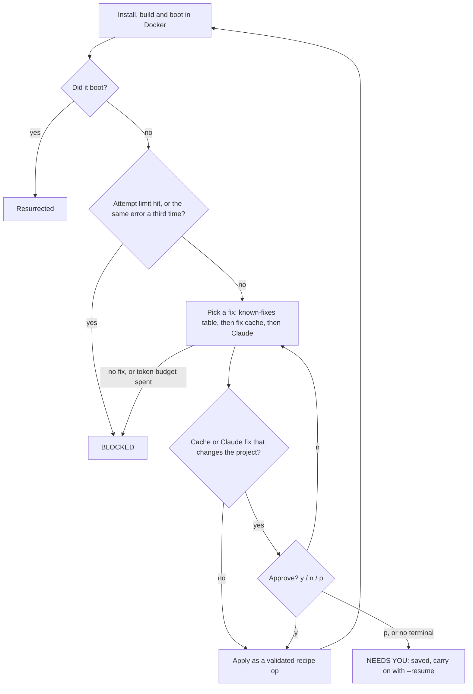
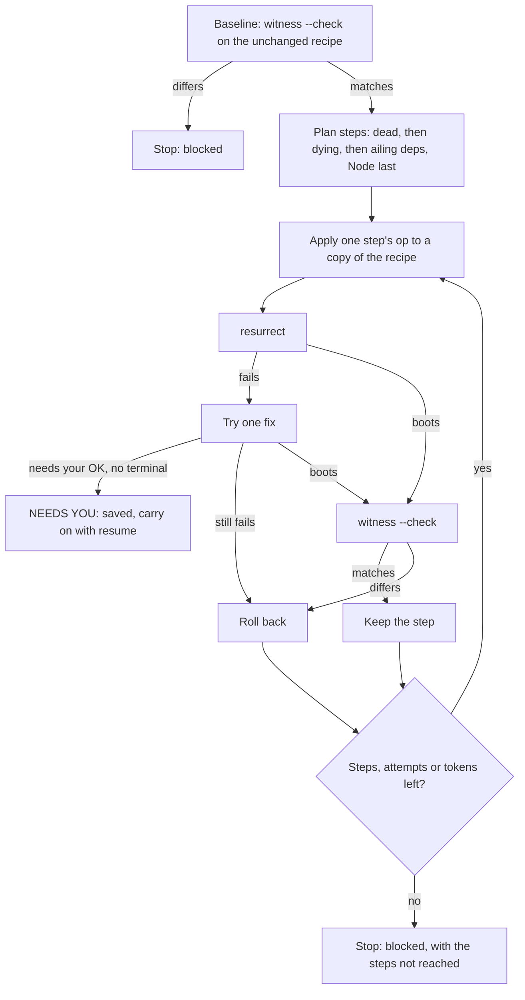

# ☠ Necromancer

Revive abandoned JavaScript and TypeScript projects.

Point it at an old repo and it maps the code, tells you which dependencies
are dead, asks what the project was for, rebuilds and starts it in Docker on
the Node version from its time, records how its routes behave, and writes an
ordered upgrade plan. Each step in the plan names a check to run after it
(`witness --check` when there are golden snapshots), so you can see whether
the step changed the app's behaviour. You make the changes yourself.

## Getting started

You need Node 22+ and git. `resurrect` and `witness` also need Docker running.
An Anthropic API key is optional: it lets Claude write fixes and test
inputs. [Setting your API key](#setting-your-api-key) shows where it goes.

### In Claude Code (plugin)

```text
/plugin marketplace add tttmaximttt/legacy-necromancer
/plugin install necromancer@legacy-necromancer
```

Restart Claude Code, then try:

```text
/necromancer:autopsy https://github.com/tttmaximttt/node-orm2
/necromancer:interview https://github.com/tttmaximttt/node-orm2
/necromancer:resurrect https://github.com/tttmaximttt/node-orm2
/necromancer:witness https://github.com/tttmaximttt/node-orm2
```

Or just ask in plain words: "exhume this repo and tell me if it's worth
reviving".

The plugin starts the MCP server with `npx`, which downloads the package the
first time. On a slow connection that can take longer than Claude Code waits
for a server to start, and `/mcp` shows it as failed. Wait a minute and
reconnect it from `/mcp`, or start Claude Code once with
`MCP_TIMEOUT=120000 claude`. You can also install it up front with
`npm install -g legacy-necromancer`, which makes every start instant.

### In Claude Code (MCP server only)

```sh
claude mcp add necromancer -- npx -y legacy-necromancer mcp
```

Claude Desktop and other clients are covered in the
[MCP README](packages/mcp/README.md).

### From the terminal

```sh
npx legacy-necromancer autopsy https://github.com/tttmaximttt/node-orm2 --open
```

or install it once with `npm install -g legacy-necromancer` and run
`necromancer <command>`. A typical session:

```sh
necromancer autopsy <repo> --open   # map + dependency graveyard, opens the UI
necromancer interview <repo>        # confirm what the project is for
necromancer resurrect <repo>        # get it running in Docker
necromancer witness <repo>          # record how it behaves
necromancer plan <repo>             # ordered upgrade steps, each with a check
# ...do a step...
necromancer witness <repo> --check  # did the behaviour change?
```

Reports are saved in `~/.necromancer/reports`, and `necromancer ui` browses
them. `autopsy` opens it straight away:


## How the agents work

### Resurrect loop



Each attempt installs, builds and boots the project in a Docker sandbox.
When a step fails, the next fix comes from a table of known fixes
([fixes.ts](packages/resurrect/src/fixes.ts)), then from a cache of fixes
Claude found for the same error before, then from Claude itself
([agent.ts](packages/resurrect/src/agent.ts)). A cache or Claude fix that
changes the project (a dependency, the Node major, commands, risky install
flags or variables) waits for your `y`, `n` (look for another fix) or `p`
(pause and exit); without a terminal the run stops with `NEEDS YOU` and
`--resume` carries on ([approval.ts](packages/resurrect/src/approval.ts)).
Every fix is a set of ops on a build recipe that are checked before the
Dockerfile is rendered from it ([recipe.ts](packages/resurrect/src/recipe.ts)).
The run ends when the app boots, or with `BLOCKED` after 10 attempts, a
150,000-token budget, the same error coming back a third time, or no fix
left to try.

### Surgeon loop

The loop is implemented in
[surgeon/src/surgeon.ts](packages/surgeon/src/surgeon.ts); run it with
[`necromancer surgeon`](#necromancer-surgeon-git-url--path) or the MCP
`surgeon` tool.



Surgeon makes the kind of upgrades `necromancer plan` describes
([plan/src/plan.ts](packages/plan/src/plan.ts)) one at a time, and keeps
only those that don't change behaviour. It first boots the unchanged recipe
and checks it still matches the golden snapshots; if it doesn't, it stops
before changing anything. The planner
([surgeon/src/plan.ts](packages/surgeon/src/plan.ts)) orders dead, dying
and ailing dependencies, then the move to Node 24, one recipe op per step,
and marks steps it already knows can't be done as skipped. Each step is
rebuilt with `resurrect`, with at most one fix that goes through the same
approval as resurrect's, and compared with `witness --check`
([compare.ts](packages/witness/src/compare.ts)); a step that still fails or
changes a response is rolled back. The run stops when the steps (20),
attempts (40, the baseline included) or tokens (150,000) run out.

## Commands

| Command | Does |
| --- | --- |
| `autopsy <repo> [--open]` | `exhume` + `graveyard`, saves both, optionally opens the UI |
| `exhume <repo> [--save]` | Architecture report (JSON) |
| `graveyard <repo> [--save]` | Era and dependency report (JSON) |
| `interview <repo>` | Claude proposes what the repo is for, with file:line evidence; you confirm or correct it and pick goals |
| `resurrect <repo>` | Builds and boots it in Docker on its era's Node, fixing failures until it runs, is `BLOCKED`, or `NEEDS YOU` |
| `witness <repo> [--check]` | Calls every route on the revived app and records normalized golden snapshots, runs its tests; `--check` compares a new run |
| `plan <repo>` | Turns the saved reports into ordered upgrade steps, each followed by a check; saves `plan.md` |
| `surgeon <repo>` | Tries each upgrade step on the resurrected recipe, keeping it only while the witness snapshots still match; `BLOCKED` or `NEEDS YOU` as `resurrect` |
| `ui [--open]` | Serves the UI over saved reports on localhost |
| `mcp` | Runs the MCP server on stdio, for Claude Code or any MCP client |

## `necromancer exhume <git-url | path>`

Clones the repo (partial clone, symlinks disabled, nothing executed), then:

1. Parses every JS/TS file with **web-tree-sitter** and extracts `import`,
   `export … from`, `require()`, `import()` and `import x = require()`.
2. Resolves specifiers the way Node would: extensions, `index` files,
   `package.json` `main`, TS-style `./x.js` → `./x.ts`.
3. Builds a directed import graph with **graphology**.
4. Clusters it with **Louvain** (seeded, so reports are reproducible).
5. Ranks **load-bearing** files by blast radius, betweenness centrality and
   git churn (from **simple-git**).
6. Audits install-time lifecycle scripts in every `package.json` (and the JS
   files they run), plus lockfile dependencies that have install scripts.
7. Flags imports that only resolve on case-insensitive filesystems: they
   work on the original author's Mac and break in a Linux container.

Test files are excluded from clusters and rankings by default; pass
`--include-tests` to keep them. Run `necromancer exhume --help` for every
option.

Trimmed output for `node-orm2`, a 2012 to 2017 ORM:

```json
{
  "stats": { "files": 114, "loc": 18760, "internalEdges": 209, "unresolvedImports": 2, "caseMismatchedImports": 1, "testFiles": 70 },
  "history": { "commits": 1337, "authors": 72, "firstCommit": "2012-11-26T17:50:49+00:00", "lastCommit": "2017-09-19T12:29:34+00:00" },
  "clusters": [
    { "id": 0, "label": "lib", "size": 15, "cohesion": 0.763, "files": ["lib/AggregateFunctions.js", "lib/Associations/Extend.js", "…"] },
    { "id": 2, "label": "lib/Drivers/DML", "size": 7, "cohesion": 1, "files": ["…"] }
  ],
  "loadBearing": [
    { "path": "lib/ORM.js", "score": 0.737, "blastRadius": 9, "betweenness": 0.094, "fanIn": 4, "fanOut": 10, "churn": 102 },
    { "path": "lib/Model.js", "score": 0.637, "blastRadius": 10, "betweenness": 0.05, "fanIn": 1, "fanOut": 12, "churn": 142 }
  ],
  "caseMismatches": [{ "from": "lib/ErrorCodes.js", "specifier": "./error", "line": 2, "target": "lib/Error.js" }]
}
```

## `necromancer graveyard <git-url | path>`

Dates the project (git history, dependency publish dates, `engines.node`)
and puts a tombstone on every dependency. It records the version the
project actually used (from the lockfile, or else the version `npm install`
would have picked the day the project died), a status of **dead**,
**dying**, **ailing** or **alive** with the reasons, known advisories, and
a suggested successor. Data comes from the npm registry, the advisory
database `npm audit` uses (or OSV.dev with `--advisories osv`), and GitHub
for archived repos. Set `GITHUB_TOKEN` to check every dependency's repo.
Details are in the [package README](packages/graveyard/README.md).

For node-orm2 it finds 22 dependencies: 1 dead, 6 dying, 13 ailing and 2
alive. lodash 4.17.4 has 10 advisories (worst critical). Its summary
reads "Lived 2012–2017; manifest written no earlier than 2017-08
(sinon@3.2.1)".

## `necromancer interview <git-url | path>`

Before anything gets revived, someone has to say what the project is for.
`interview` shows Claude the README, the manifest, the entry points, the
load-bearing files from `exhume` and one file per cluster, with line
numbers, and asks for a structured answer: a summary, what the project
does, what a revival must keep working, suggested goals and open questions.
Every claim cites `file:line` and quotes the lines. Necromancer then checks
each quote against the repo: quotes on the wrong lines are moved, and
quotes it can't find are marked "not found" and flagged.

You then confirm the summary or replace it with your own words, pick
suggested goals by number and add your own. Later stages read the result
(`intent` and `goals` in `interview.json`).

```sh
export ANTHROPIC_API_KEY=…   # or see "Setting your API key"
necromancer interview https://github.com/tttmaximttt/node-orm2              # asks interactively
necromancer interview --reuse <repo> --yes --accept-goals 1,2 --goal "…"   # or answer with flags
```

It uses `claude-opus-5-5` at medium effort by default (`--model`,
`--effort`). If the model declines, the API retries once on Anthropic's
recommended fallback model (`--no-fallbacks` turns that off), and the
report notes which model answered. Through MCP, the `interview` tool works
without an API key too: the agent you're talking to gets the evidence and
writes the proposal itself, and `record_interview` checks its citations the
same way. Details are in the [package README](packages/interview/README.md).

## `necromancer resurrect <git-url | path>`

Builds the project in Docker on the Node version of its era, with its
databases alongside, and boots it until its port answers. A 2017 Express
and Mongoose app gets `node:6` and `mongo:3.4`. When a step fails, the
next change comes from a table of known fixes (node-gyp needing Python,
node-sass, end-of-life Debian mirrors, phantomjs downloads, peer
dependencies…), then from fixes the model found for the same error before,
then from Claude. It stops with `BLOCKED: <reason>` after 10 attempts
(`--max-iterations`), when Claude has used 150,000 tokens (`--token-budget`),
when the same error comes back a third time, or when no fix applies.

```sh
necromancer resurrect https://github.com/owner/old-app --out-dir ./revived
```

`--out-dir` also writes `Dockerfile.necromancer` and
`docker-compose.necromancer.yml` with the same limits, for running it
yourself. Without `ANTHROPIC_API_KEY` only known fixes and fixes already
in the cache are tried (`--no-llm` forces that). The exit code is 2 when blocked. Details,
including the sandbox, are in the [package README](packages/resurrect/README.md).

Some fixes change the project rather than the sandbox: a dependency
version, the Node major, system packages, where and how packages are
installed (install flags, a registry, npm settings), environment
variables, or the build or start command. Built-in fixes from the table
are applied without asking, and the report lists each one that changed the
project. Fixes from the cache or from Claude that change the project wait
for your OK, except a short allow-list of harmless install flags and
variables (such as `--legacy-peer-deps` or `CI`). In a terminal you see
the fix, what it would change and the error it is for, and answer `y` to
apply it, `n` to look for another fix, or `p` to pause and exit (the run is
saved, as below). When Claude needs something only you
know, such as what to do about a private package, it asks, with numbered
suggestions; type a number or your own answer, or press Enter to pause.
Only cache and Claude fixes are ever asked about. `--yes` applies those
without asking too (the report records them as approved automatically),
except the one a `--resume` is waiting on: that takes `--approve` or
`--reject`.

Without a terminal to ask on (in CI, or piped), the run stops at the first
such fix or question with `NEEDS YOU`, saves where it got to, prints the
command to carry on, and exits with code 3:

```sh
necromancer resurrect <repo> --resume --approve        # apply the fix it stopped on
necromancer resurrect <repo> --resume --reject         # look for another fix
necromancer resurrect <repo> --resume --answer "stub it"
```

A resumed run keeps the paused run's settings (model or `--no-llm`, limits,
`--keep-images`, `--workdir`, `--build-proxy`, `--health-timeout`); only the
flags you type again change them, and `--no-build-proxy` turns the proxy off.
Claude turns your answer into a fix, so `--answer` needs an API key. When the
question lists numbered choices, `--answer 2` picks the second one.

Through MCP, the agent you're talking to asks you instead and carries on
with your answer.

## `necromancer witness <git-url | path>`

Boots the app the way `resurrect` got it running and calls every route that
`exhume` found. Claude writes the requests from the handler code (one to
three per route), or each route gets one placeholder request without
`ANTHROPIC_API_KEY`. The responses are saved as golden snapshots, with
timestamps, ids, tokens and anything else that changes between two
identical requests blanked. The project's own `test` script runs next to the
app.

```sh
necromancer witness https://github.com/owner/old-app
# later, after changing something:
necromancer witness https://github.com/owner/old-app --check
```

`--check` re-sends the saved requests, prints what changed (status, headers,
body, tests), exits 1 on any difference, and keeps the golden snapshots.
Details are in the [package README](packages/witness/README.md).

## `necromancer plan <git-url | path>`

Reads the reports saved for the repo and writes a modernization plan: one
step at a time, lowest risk first. Fix imports that break on Linux, remove
dead packages nothing imports, upgrades within the same major, replace dead
packages with their successors, then major upgrades, then devDependency
upgrades, and the move to Node 24 last. Each step says why (deprecations, advisories,
what `resurrect` had to pin), which of your interview goals it serves, and
the check to run after it: `witness --check` when there are golden
snapshots, otherwise the project's tests or another `resurrect`.

```sh
necromancer plan https://github.com/owner/old-app          # prints the plan as Markdown
necromancer plan https://github.com/owner/old-app --json   # or as JSON
```

It needs a saved `graveyard` report (`autopsy` saves one); the more of the
other reports there are, the better the plan. It saves `plan.md` and
`plan.json` next to them. No API key or network is needed.

## `necromancer surgeon <git-url | path>`

Upgrades the recipe `resurrect` got running, one step at a time: dead,
dying and ailing dependencies first, then the move to Node 24
(`--target-node` picks another release). It needs saved `graveyard`,
`resurrect` and `witness` reports, and says which command to run first
when one is missing. Before any step it boots the unchanged recipe and
replays the golden requests; if anything differs it stops, since a later
difference could not be blamed on a step.

Each step changes one thing, gets one build attempt plus one fix if the
first fails, and is then checked with the golden requests. It is kept only
when every response matches, and rolled back otherwise. The output lists
every step: kept, rolled back (with whether it failed in `resurrect` or in
the witness check, and the first few differences), or skipped and why.

```sh
necromancer surgeon https://github.com/owner/old-app --out-dir ./upgraded
```

The run stops with `BLOCKED: <reason>` and lists the steps it did not reach
when it has run 20 steps (`--max-steps`), used 40 resurrect attempts with the
baseline (`--max-attempts`), or used 150,000 tokens (`--token-budget`). The
sandbox limits default to the ones the `resurrect` run used (`--cpus`,
`--memory`, `--step-timeout`). `--out-dir` writes the upgraded
`Dockerfile.necromancer` and `docker-compose.necromancer.yml`. The full
report is saved as `surgeon.json`.

Fixes wait for your OK as they do in `resurrect`: `y`, `n` or `p` in a
terminal, `--yes` to apply them without asking. Without a terminal the run
stops at the step with `NEEDS YOU` and exits with code 3:

```sh
necromancer surgeon <repo> --resume --approve     # apply the fix it stopped on
necromancer surgeon <repo> --resume --reject      # decline it; the step is rolled back unless another fix is found
necromancer surgeon <repo> --resume --answer "stub it"
```

A resumed run keeps the paused run's budgets and settings, so the flags
that set them can't be typed with `--resume`. It refuses to carry on if the
saved reports changed since it paused. The exit code is 0 when every step
was kept, rolled back or skipped, 2 when blocked and 3 for `NEEDS YOU`.

## Setting your API key

Three commands call Claude: `interview` asks what the project is for,
`resurrect` asks for a fix when no known fix applies, and `witness` asks
for test requests. Everything else works without a key, and so do these
three, just with less help:

- `interview` in the terminal needs the key to make a proposal (answering a
  saved one with `--reuse` doesn't). Through the MCP server it doesn't: the
  Claude you're talking to writes the proposal instead.
- `resurrect` only tries the known fixes and fixes already in the cache.
- `witness` sends one placeholder request per route.

Create a key at [platform.claude.com](https://platform.claude.com/settings/keys).
Calls are billed to that API account, not to a Claude subscription.

Necromancer takes the first key it finds here:

1. `NECROMANCER_ANTHROPIC_API_KEY` in its environment (the plugin setting
   ends up here)
2. `ANTHROPIC_API_KEY`, then `ANTHROPIC_AUTH_TOKEN`, in its environment
3. the same variables in the file `~/.necromancer/.env`

Only that one key is used. `ANTHROPIC_BASE_URL` is read from the same place
as the key, so a key from your shell is never sent to a gateway set in the
file, or the other way round.

### One file for everything

The file works the same way for the terminal, the plugin, the MCP server and
Claude Desktop, so it's the simplest option:

```sh
mkdir -p ~/.necromancer
touch ~/.necromancer/.env
chmod 600 ~/.necromancer/.env
```

Open it in an editor and add:

```sh
ANTHROPIC_API_KEY=sk-ant-...
```

Variables that are already set in the environment win over the file. Other
settings can go there too, such as `GITHUB_TOKEN` for `graveyard`. Settings
that Node reads when it starts, such as `NODE_USE_ENV_PROXY` or
`NODE_EXTRA_CA_CERTS`, don't work from the file.

### Claude Code plugin

`/plugin install` asks for the key. The field is optional, and it needs
Claude Code 2.1.119 or later (`claude update`). Claude Code
keeps it in secure storage (the macOS Keychain, or `~/.claude/.credentials.json`
on Linux) and passes it only to the Necromancer server. To add or change it
later, run `/plugin configure necromancer@legacy-necromancer` and restart
Claude Code.

Don't export `ANTHROPIC_API_KEY` in the shell you start `claude` from just
for Necromancer. Claude Code would then use that key for itself and bill
your API account instead of your Claude subscription. Use the plugin
setting or the file instead.

### Claude Code, MCP server only

```sh
claude mcp add necromancer -e NECROMANCER_ANTHROPIC_API_KEY=sk-ant-... -- npx -y legacy-necromancer mcp
```

If you already added the server, remove it first with
`claude mcp remove necromancer`. This saves the key in plain text in
`~/.claude.json`. The file above keeps it out of your Claude Code config.

### Claude Desktop

Claude Desktop doesn't pass your shell's variables to servers. Use the file,
or add the key to the server in `claude_desktop_config.json`:

```json
"env": { "NECROMANCER_ANTHROPIC_API_KEY": "sk-ant-..." }
```

### Terminal

```sh
export ANTHROPIC_API_KEY=sk-ant-...
```

That lasts for one shell session. Use the file to keep it. If you also run
Claude Code from that shell, export `NECROMANCER_ANTHROPIC_API_KEY` instead,
for the reason above.

### CI

Save the key as a secret and pass it as a variable. In a GitHub Actions job
on `ubuntu-latest`, which has Docker:

```yaml
- run: npx -y legacy-necromancer resurrect .
  env:
    ANTHROPIC_API_KEY: ${{ secrets.ANTHROPIC_API_KEY }}
```

### Through an API gateway

If your company sends Anthropic traffic through its own gateway, set
`ANTHROPIC_BASE_URL` to it, plus `ANTHROPIC_AUTH_TOKEN` if it expects a
bearer token instead of a key. Put both in `~/.necromancer/.env` rather than
the shell you start Claude Code from, which would point Claude Code at the
gateway too. The gateway has to pass requests to Anthropic unchanged,
including beta headers and the model name `claude-opus-5-5`. Other
providers, such as Bedrock, Vertex or OpenAI, aren't supported yet.

## Safety

Excavate only reads. It never installs dependencies or runs repo code.
Resurrect does run repo code, including install scripts, but only in
containers: no host mounts, no credentials, network only while installing,
and CPU, memory, process and time limits on everything.
Witness runs the app in the same sandbox and sends requests to it from
inside. Interview sends the files it picked (up to about 2,400 lines) to the
Anthropic API, and Witness sends about 30 lines around each route handler;
don't run them on code you can't share with it. Don't point any of it at
shared environments or production.
