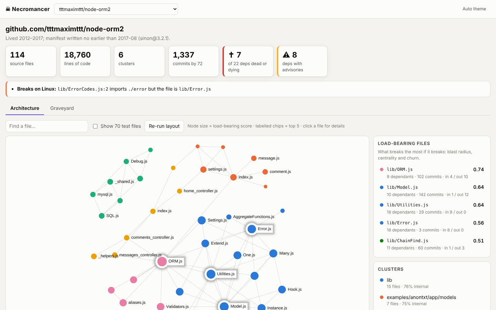
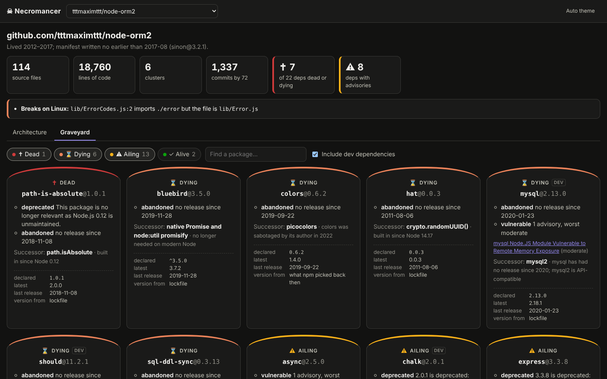

# ☠ Necromancer

Revive abandoned JavaScript and TypeScript projects.

Point it at an old repo and it maps the code, tells you which dependencies
are dead, asks what the project was for, rebuilds and starts it in Docker on
the Node version from its time, and records how its routes behave so you can
upgrade it without breaking anything.

## Getting started

You need Node 22+ and git. `resurrect` and `witness` also need Docker running.
Set `ANTHROPIC_API_KEY` if you want Claude to write fixes and test inputs;
everything else works without it.

### In Claude Code (plugin)

```text
/plugin marketplace add tttmaximttt/legacy-necromancer
/plugin install necromancer@legacy-necromancer
```

Restart Claude Code, then try:

```text
/necromancer:autopsy https://github.com/tttmaximttt/node-orm2
/necromancer:interview https://github.com/tttmaximttt/node-orm2
/necromancer:resurrect https://github.com/tttmaximttt/node-orm2
/necromancer:witness https://github.com/tttmaximttt/node-orm2
```

Or just ask in plain words: "exhume this repo and tell me if it's worth
reviving". The plugin starts the MCP server with `npx`, so the first call
takes a few seconds while it downloads.

### In Claude Code (MCP server only)

```sh
claude mcp add necromancer -- npx -y legacy-necromancer mcp
```

Claude Desktop and other clients are covered in the
[MCP README](packages/mcp/README.md).

### From the terminal

```sh
npx legacy-necromancer autopsy https://github.com/tttmaximttt/node-orm2 --open
```

or install it once with `npm install -g legacy-necromancer` and run
`necromancer <command>`. A typical session:

```sh
necromancer autopsy <repo> --open   # map + dependency graveyard, opens the UI
necromancer interview <repo>        # confirm what the project is for
necromancer resurrect <repo>        # get it running in Docker
necromancer witness <repo>          # record how it behaves
# ...upgrade something...
necromancer witness <repo> --check  # did the behaviour change?
```

Reports are saved in `~/.necromancer/reports`, and `necromancer ui` browses
them. `autopsy` opens it straight away:





## Design

A pipeline in which only two steps are agents and two make a single model
call. Everything else is deterministic, seeded, and testable without an LLM;
the model call is tested against a scripted model, so no API key is needed.

| Phase | Package | Kind | Status |
| --- | --- | --- | --- |
| 1. Excavate | [`excavate`](packages/excavate) | deterministic | **working** |
| 2. Date + Graveyard | [`graveyard`](packages/graveyard) | deterministic | **working** |
| 3. Map | [`ui`](packages/ui) | UI | **working** |
| 4. Interview | [`interview`](packages/interview) | one structured LLM call + the user | **working** |
| 5. Resurrect | [`resurrect`](packages/resurrect) | agent (known-fix table first) | **working** |
| 6. Witness | [`witness`](packages/witness) | deterministic, inputs from one LLM call | **working** |
| Stretch: Operate | [`surgeon`](packages/surgeon) | agent | stub |

Shared code lives in [`core`](packages/core) (report types, seeded RNG) and
[`llm`](packages/llm) (structured-output Claude client, plus a scripted
model for tests). The command line is
[`cli`](packages/cli), and the MCP server is [`mcp`](packages/mcp).

Phases 1 to 3 are the first demo: no Docker, no LLM, just "here's what this
dead repo is and what's rotting in it".

## Commands

| Command | Does |
| --- | --- |
| `autopsy <repo> [--open]` | `exhume` + `graveyard`, saves both, optionally opens the UI |
| `exhume <repo> [--save]` | Phase 1 architecture report (JSON) |
| `graveyard <repo> [--save]` | Phase 2 era + dependency report (JSON) |
| `interview <repo>` | Phase 4: Claude proposes what the repo is for, with file:line evidence; you confirm or correct it and pick goals |
| `resurrect <repo>` | Phase 5: builds and boots it in Docker on its era's Node, fixing failures until it runs or is `BLOCKED` |
| `witness <repo> [--check]` | Phase 6: calls every route on the revived app and records normalized golden snapshots, runs its tests; `--check` compares a new run |
| `ui [--open]` | Serves the UI over saved reports on localhost |
| `mcp` | Runs the MCP server on stdio, for Claude Code or any MCP client |

## `necromancer exhume <git-url | path>`

Clones the repo (partial clone, symlinks disabled, nothing executed), then:

1. Parses every JS/TS file with **web-tree-sitter** and extracts `import`,
   `export … from`, `require()`, `import()` and `import x = require()`.
2. Resolves specifiers the way Node would: extensions, `index` files,
   `package.json` `main`, TS-style `./x.js` → `./x.ts`.
3. Builds a directed import graph with **graphology**.
4. Clusters it with **Louvain** (seeded, so reports are reproducible).
5. Ranks **load-bearing** files by blast radius, betweenness centrality and
   git churn (from **simple-git**).
6. Audits install-time lifecycle scripts in every `package.json` (and the JS
   files they run), plus lockfile dependencies that have install scripts.
7. Flags imports that only resolve on case-insensitive filesystems: they
   work on the original author's Mac and break in a Linux container.

Test files are excluded from clusters and rankings by default; pass
`--include-tests` to keep them. Run `necromancer exhume --help` for every
option.

Trimmed output for `node-orm2`, a 2012 to 2017 ORM:

```json
{
  "stats": { "files": 114, "loc": 18760, "internalEdges": 209, "unresolvedImports": 2, "caseMismatchedImports": 1, "testFiles": 70 },
  "history": { "commits": 1337, "authors": 72, "firstCommit": "2012-11-26T17:50:49+00:00", "lastCommit": "2017-09-19T12:29:34+00:00" },
  "clusters": [
    { "id": 0, "label": "lib", "size": 15, "cohesion": 0.763, "files": ["lib/AggregateFunctions.js", "lib/Associations/Extend.js", "…"] },
    { "id": 2, "label": "lib/Drivers/DML", "size": 7, "cohesion": 1, "files": ["…"] }
  ],
  "loadBearing": [
    { "path": "lib/ORM.js", "score": 0.737, "blastRadius": 9, "betweenness": 0.094, "fanIn": 4, "fanOut": 10, "churn": 102 },
    { "path": "lib/Model.js", "score": 0.637, "blastRadius": 10, "betweenness": 0.05, "fanIn": 1, "fanOut": 12, "churn": 142 }
  ],
  "caseMismatches": [{ "from": "lib/ErrorCodes.js", "specifier": "./error", "line": 2, "target": "lib/Error.js" }]
}
```

## `necromancer graveyard <git-url | path>`

Dates the project (git history, dependency publish dates, `engines.node`)
and puts a tombstone on every dependency. It records the version the
project actually used (from the lockfile, or else the version `npm install`
would have picked the day the project died), a status of **dead**,
**dying**, **ailing** or **alive** with the reasons, known advisories, and
a suggested successor. Data comes from the npm registry, the advisory
database `npm audit` uses (or OSV.dev with `--advisories osv`), and GitHub
for archived repos. Set `GITHUB_TOKEN` to check every dependency's repo.
Details are in the [package README](packages/graveyard/README.md).

For node-orm2 it finds 22 dependencies: 1 dead, 6 dying, 13 ailing and 2
alive. lodash 4.17.4 has 10 advisories (worst critical). Its summary
reads "Lived 2012–2017; manifest written no earlier than 2017-08
(sinon@3.2.1)".

## `necromancer interview <git-url | path>`

Before anything gets revived, someone has to say what the project is for.
`interview` shows Claude the README, the manifest, the entry points, the
load-bearing files from `exhume` and one file per cluster, with line
numbers, and asks for a structured answer: a summary, what the project
does, what a revival must keep working, suggested goals and open questions.
Every claim cites `file:line` and quotes the lines. Necromancer then checks
each quote against the repo: quotes on the wrong lines are moved, and
quotes it can't find are marked "not found" and flagged.

You then confirm the summary or replace it with your own words, pick
suggested goals by number and add your own. Later stages read the result
(`intent` and `goals` in `interview.json`).

```sh
export ANTHROPIC_API_KEY=…
pnpm necromancer interview https://github.com/tttmaximttt/node-orm2              # asks interactively
pnpm necromancer interview --reuse <repo> --yes --accept-goals 1,2 --goal "…"   # or answer with flags
```

It uses `claude-opus-5-5` at medium effort by default (`--model`,
`--effort`). If the model declines, the API retries once on Anthropic's
recommended fallback model (`--no-fallbacks` turns that off), and the
report notes which model answered. Through MCP, the `interview` tool works
without an API key too: the agent you're talking to gets the evidence and
writes the proposal itself, and `record_interview` checks its citations the
same way. Details are in the [package README](packages/interview/README.md).

## `necromancer resurrect <git-url | path>`

Builds the project in Docker on the Node version of its era, with its
databases alongside, and boots it until its port answers. A 2017 Express
and Mongoose app gets `node:6` and `mongo:3.4`. When a step fails, the
next change comes from a table of known fixes (node-gyp needing Python,
node-sass, end-of-life Debian mirrors, phantomjs downloads, peer
dependencies…), then from fixes the model found for the same error before,
then from Claude. It stops after 10 attempts, at a token budget, or when no
fix applies, with `BLOCKED: <reason>`.

```sh
pnpm necromancer resurrect https://github.com/owner/old-app --out-dir ./revived
```

`--out-dir` also writes `Dockerfile.necromancer` and
`docker-compose.necromancer.yml` with the same limits, for running it
yourself. Without `ANTHROPIC_API_KEY` only known fixes are tried
(`--no-llm` forces that). The exit code is 2 when blocked. Details,
including the sandbox, are in the [package README](packages/resurrect/README.md).

## `necromancer witness <git-url | path>`

Boots the app the way `resurrect` got it running and calls every route that
`exhume` found. Claude writes the requests from the handler code (one to
three per route), or each route gets one placeholder request without
`ANTHROPIC_API_KEY`. The responses are saved as golden snapshots, with
timestamps, ids, tokens and anything else that changes between two
identical requests blanked. The project's own `test` script runs next to the
app.

```sh
pnpm necromancer witness https://github.com/owner/old-app
# later, after changing something:
pnpm necromancer witness https://github.com/owner/old-app --check
```

`--check` re-sends the saved requests, prints what changed (status, headers,
body, tests), exits 1 on any difference, and keeps the golden snapshots.
Details are in the [package README](packages/witness/README.md).

## Safety

Excavate only reads. It never installs dependencies or runs repo code.
Resurrect does run repo code, including install scripts, but only in
containers: no host mounts, no credentials, network only while installing,
and CPU, memory, process and time limits on everything.
Witness runs the app in the same sandbox and sends requests to it from
inside. Interview sends the files it picked (up to about 2,400 lines) to the
Anthropic API, and Witness sends about 30 lines around each route handler;
don't run them on code you can't share with it. Operate must follow the same
rules, and none of it should ever point at shared environments or
production.

## Development

Node 22+, pnpm 10.

```sh
pnpm build        # tsc -b across all packages
pnpm test         # vitest
pnpm necromancer  # run the built CLI
```

Inside this repo, Claude Code picks up the local MCP server from `.mcp.json`
after `pnpm build`.

### Releasing

The npm package is [`packages/legacy-necromancer`](packages/legacy-necromancer):
the CLI and MCP server bundled into one file. To release:

1. Bump `version` in `packages/legacy-necromancer/package.json`,
   `plugin/.claude-plugin/plugin.json` and the `npx` pin in
   `plugin/.mcp.json` (the build fails if they differ).
2. Commit, then tag and push: `git tag v0.1.1 && git push origin v0.1.1`.

The release workflow builds, tests and publishes to npm. It needs an
`NPM_TOKEN` repository secret.
